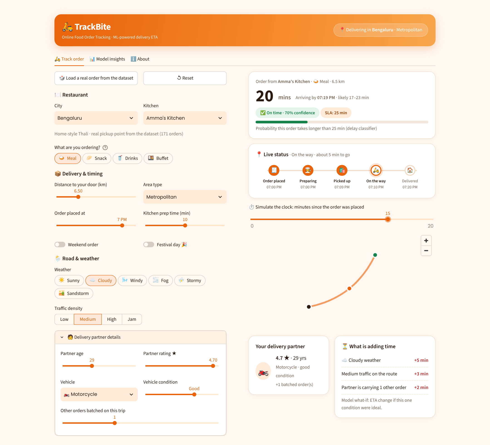
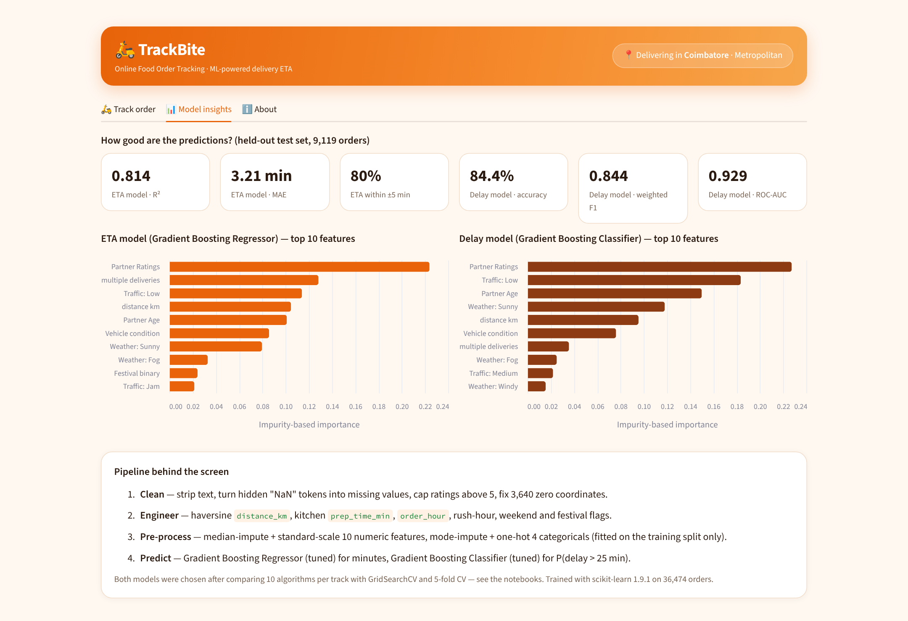

# Online Food Order Tracking — End-to-End ML Pipeline

**23CSE301 Machine Learning · Capstone Project (2026-27) · Amrita Vishwa Vidyapeetham**

We predict **how long a food delivery will take**, **whether it will breach a 25-minute delivery SLA**, and **which kinds of orders behave alike**, using 45,593 real food-delivery orders from 22 Indian cities. All three tracks (Regression, Classification and Clustering) share one cleaning and feature-engineering pipeline. The final models also power **TrackBite**, an interactive Streamlit order tracker (bonus GUI).

| | |
|---|---|
| **Team** | _Add the three member names and roll numbers here_ |
| **Track owners** | Regression: _name_ · Classification: _name_ · Clustering: _name_ |
| **Repository** | https://github.com/Sank19-code/Online-Food-Order-Tracking |
| **Live demo** | _Add your Streamlit Community Cloud URL after deploying (see below)_ |

---

## 1. Problem statement

A food-delivery platform has to tell customers when their order will arrive, and it has to flag orders that are likely to be late before they are late. Using order, rider, road and weather information known at dispatch time, we:

| Track | Task | Target |
|---|---|---|
| **Regression** | Predict the delivery time in minutes | `Time_taken` (from `Time_taken(min)`) |
| **Classification** | Predict whether the order breaches the SLA | `Is_Delayed = 1` if `Time_taken > 25` min (classes are balanced: 50.1% / 49.9%) |
| **Clustering** | Group orders into operational segments without using labels | — (labels used only afterwards, to interpret the clusters) |

## 2. Dataset

`data/train.csv`: **45,593 orders × 20 columns** (11,399 more orders in `test.csv`, which has no target and is not used for evaluation). Every order comes from one of 22 cities, coded in the rider ID (e.g. `BANGRES18DEL02` = Bengaluru).

| Group | Columns |
|---|---|
| Identifiers | `ID`, `Delivery_person_ID` |
| Delivery partner | `Delivery_person_Age`, `Delivery_person_Ratings`, `Type_of_vehicle`, `Vehicle_condition` (0–3), `multiple_deliveries` (0–3) |
| Location | `Restaurant_latitude/longitude`, `Delivery_location_latitude/longitude`, `City` (Metropolitan / Urban / Semi-Urban) |
| Time | `Order_Date`, `Time_Orderd`, `Time_Order_picked` |
| Conditions | `Weatherconditions` (6 types), `Road_traffic_density` (Low / Medium / High / Jam), `Festival` |
| Order | `Type_of_order` (Snack / Meal / Drinks / Buffet) |
| **Target** | `Time_taken(min)`: 10–54 min, mean 26.3 min |

**Data-quality issues found and fixed**

- Hidden missing values stored as the text `"NaN "` in 8 columns (for example 1,854 ages, 1,908 ratings and 993 `multiple_deliveries`). These are converted to real NaN, then median-imputed (numeric) or mode-imputed (categorical) **inside the pipeline, fitted on the training split only**.
- 53 ratings above 5 (data-entry errors) are capped at 5.
- 3,640 orders with near-zero coordinates get the median distance.
- Trailing spaces and prefixes (`"conditions Sunny"`, `"(min) 24"`) are stripped. No duplicate IDs were found.

## 3. Pipeline

```
train.csv ──► clean_and_engineer() ──► stratified 80:20 split (random_state=42)
                    │                         │
                    │                         ├─► ColumnTransformer fitted on TRAIN only
                    │                         │     numeric: median impute + StandardScaler (10 features)
                    │                         │     categorical: mode impute + OneHotEncoder (4 features → 13 dummies)
                    │                         │
                    │                         ├─► Regression: 10 models ─► GridSearchCV ─► tuned GBR
                    │                         ├─► Classification: 10 models ─► GridSearchCV ─► tuned GBC
                    │                         └─► Clustering: K-Means & Agglomerative (8 features, no labels)
                    │
                    └─► engineered features (why they help)
                          distance_km      haversine restaurant → customer distance; raw coordinates say nothing on their own
                          prep_time_min    order → pickup gap (kitchen delay), with the overnight wrap fixed
                          order_hour, is_rush_hour (12–14 h, 19–21 h), is_weekend, Festival_binary
                          traffic_level    ordinal 0–3 encoding of traffic density (clustering)
```

The same functions live in every notebook and in `src/pipeline.py`, so the notebooks, the training script and the GUI all use the same features.

## 4. Results

All metrics are on the same held-out test set of **9,119 orders**.

### 4.1 Regression: predicting delivery time (10 algorithms, ranked by R²)

| Rank | Algorithm | R² | RMSE (min) | MAE (min) |
|---|---|---|---|---|
| 1 | Random Forest Regressor | 0.8102 | 4.089 | 3.222 |
| 2 | Gradient Boosting Regressor | 0.7985 | 4.214 | 3.346 |
| 3 | Decision Tree Regressor | 0.7828 | 4.374 | 3.413 |
| 4 | Support Vector Regressor (SVR) | 0.7204 | 4.964 | 3.887 |
| 5 | K-Nearest Neighbors Regressor | 0.6953 | 5.181 | 4.047 |
| 6 | Polynomial Regression (degree 2) | 0.6252 | 5.747 | 4.581 |
| 7 | Ridge Regression | 0.5921 | 5.995 | 4.756 |
| 8 | Linear Regression | 0.5918 | 5.997 | 4.756 |
| 9 | Lasso Regression | 0.5844 | 6.051 | 4.787 |
| 10 | ElasticNet Regression | 0.5786 | 6.093 | 4.828 |

5-fold CV R² for the two best models: Random Forest **0.805 ± 0.003**, Gradient Boosting **0.793 ± 0.003**.

**Hyperparameter tuning (GridSearchCV)**

| Model | Best parameters | R² before → after |
|---|---|---|
| Ridge | `alpha=0.01` | 0.5921 → 0.5918 |
| Random Forest | `n_estimators=300, max_depth=14, min_samples_leaf=1` | 0.8102 → 0.8108 |
| **Gradient Boosting** | `learning_rate=0.05, max_depth=7, n_estimators=200` | 0.7985 → **0.8134** |

**Final model: tuned Gradient Boosting Regressor.** It reaches R² 0.813, RMSE 4.05 min and MAE 3.21 min, and **80% of orders are predicted within ±5 minutes**. Rider rating, multiple deliveries, low traffic, distance and rider age are its most important features.

### 4.2 Classification: predicting SLA breach (> 25 min), all 10 algorithms

| Rank | Algorithm | Part | Accuracy | Precision (W) | Recall (W) | F1 (W) | ROC-AUC |
|---|---|---|---|---|---|---|---|
| 1 | Gradient Boosting | B | 0.8329 | 0.8352 | 0.8329 | 0.8326 | 0.9151 |
| 2 | MLP Neural Network | B | 0.8306 | 0.8340 | 0.8306 | 0.8302 | 0.9195 |
| 3 | Random Forest | B | 0.8275 | 0.8284 | 0.8275 | 0.8274 | 0.9196 |
| 4 | Bagging (Decision Tree) | B | 0.8257 | 0.8262 | 0.8257 | 0.8257 | 0.9190 |
| 5 | Support Vector Classifier | A | 0.8186 | 0.8199 | 0.8186 | 0.8185 | 0.9016 |
| 6 | Decision Tree | A | 0.8104 | 0.8202 | 0.8104 | 0.8090 | 0.8998 |
| 7 | K-Nearest Neighbors | A | 0.7986 | 0.7992 | 0.7986 | 0.7985 | 0.8811 |
| 8 | AdaBoost | B | 0.7955 | 0.7957 | 0.7955 | 0.7954 | 0.8829 |
| 9 | Logistic Regression | A | 0.7857 | 0.7857 | 0.7857 | 0.7857 | 0.8689 |
| 10 | Gaussian Naive Bayes | A | 0.5251 | 0.7466 | 0.5251 | 0.3885 | 0.8486 |

5-fold CV for the two best models: Gradient Boosting F1 **0.833 ± 0.004**, MLP F1 **0.827 ± 0.004**.

**Hyperparameter tuning (Part B models)**

| Model | Best parameters | F1 before → after | ROC-AUC before → after |
|---|---|---|---|
| **Gradient Boosting** | `learning_rate=0.05, max_depth=5, n_estimators=200` | 0.8326 → **0.8439** | 0.9151 → **0.9290** |
| Random Forest | `n_estimators=300, max_depth=None, min_samples_leaf=3` | 0.8274 → 0.8391 | 0.9196 → 0.9256 |
| MLP | `hidden_layer_sizes=(128, 64), activation='tanh', alpha=0.001` | 0.8302 → 0.8385 | 0.9195 → 0.9276 |
| Bagging | `n_estimators=150, max_samples=0.7` | 0.8257 → 0.8307 | 0.9190 → 0.9229 |
| AdaBoost | `n_estimators=300, learning_rate=0.5` | 0.7954 → 0.7985 | 0.8829 → 0.8851 |

**Final model: tuned Gradient Boosting Classifier.** It scores Accuracy 84.4%, weighted F1 0.844 and ROC-AUC 0.929. For the *Delayed* class, precision is 0.881 and recall is 0.797.

### 4.3 Clustering: order segments (k = 4)

| Algorithm | Silhouette ↑ | Davies-Bouldin ↓ | Calinski-Harabasz ↑ |
|---|---|---|---|
| **K-Means (k = 4)** | **0.150** | **2.032** | **719.9** |
| Agglomerative, Ward linkage (k = 4) | 0.126 | 2.092 | 593.3 |

k = 4 was chosen from the elbow curve and the dendrogram. Ward was the only linkage that did not collapse into one giant cluster (average and single linkage put more than 99% of orders in one cluster). Interpreted afterwards with the labels, the K-Means segments are: **short daytime trips** (4.1 km, 34% delayed), **evening long trips in light traffic** (38% delayed), **evening trips in jam traffic** (64% delayed) and a **high-risk segment** (rating 4.0, older riders, more batched orders, heavy traffic: **98% delayed, 37 min average**). Cluster plots use PCA (2 components) and t-SNE.

## 5. Interactive GUI: TrackBite (bonus)

`app/app.py` is a Streamlit order tracker styled like a food-delivery app. Choose a city and kitchen, then set the distance, time, weather, traffic and delivery-partner details. You can also click **🎲 Load a real order** to fill every field from the dataset and compare the prediction with what really happened. The app shows:

- **ETA and arrival time** from the tuned Gradient Boosting Regressor, with a ±MAE range;
- an **on-time / likely-delayed badge** with the SLA-breach probability from the tuned Gradient Boosting Classifier;
- a **live status timeline** (placed → preparing → picked up → on the way → delivered) and a route map, both driven by a "simulate the clock" slider;
- **"What is adding time"**: a model what-if that re-predicts the ETA with each condition set to its ideal value (for example Jam → Low traffic, or no batched orders);
- a **Model insights** tab with test-set metrics and feature importances.

| Tracker | Model insights |
|---|---|
|  |  |

The kitchen names in the app are invented labels placed on real pickup coordinates. The route on the map is drawn for illustration; the model uses only the distance.

## 6. Repository structure

```
README.md               project overview, results, setup (this file)
requirements.txt        pinned Python dependencies
data/                   train.csv, test.csv
notebooks/              regression.ipynb, classification.ipynb, clustering.ipynb, capstone_review1_PCA.ipynb
src/pipeline.py         shared cleaning, feature engineering and preprocessing
src/train_models.py     re-trains and saves the two final models
models/                 best_regressor.pkl, best_classifier.pkl (joblib)
app/app.py              Streamlit GUI
.streamlit/config.toml  GUI theme
docs/                   screenshots
```

## 7. Environment setup

```bash
git clone https://github.com/Sank19-code/Online-Food-Order-Tracking.git
cd Online-Food-Order-Tracking
python -m venv .venv
# Windows: .venv\Scripts\activate      macOS/Linux: source .venv/bin/activate
pip install -r requirements.txt
```

Python 3.10 or newer. All randomness is seeded with `random_state = 42`.

## 8. How to run

**Notebooks.** Open them in Jupyter and use *Kernel → Restart & Run All*, in this order: `regression.ipynb` → `classification.ipynb` → `clustering.ipynb`. They find `train.csv` in the same folder or in `data/`. The last cells of the regression and classification notebooks save the final models to `models/`.

**Re-create the models without the notebooks** (about 40 seconds):

```bash
python src/train_models.py
```

**Start the GUI:**

```bash
streamlit run app/app.py
```

The app loads `models/*.pkl`. If they are missing, or were saved with a different scikit-learn version, it re-trains them once from `data/train.csv`.

**Deploy publicly (bonus +1):** push the repository to GitHub, sign in at [share.streamlit.io](https://share.streamlit.io), choose *Create app*, then select this repository, branch `main` and main file `app/app.py`.

## 9. Key findings

- Delivery time depends on **thresholds and interactions**, not straight-line effects. Every festival-day order and every trip with 2+ batched deliveries breaches the SLA, and the delay rate rises from 25% in low traffic to 70% in jam traffic. This is why tree ensembles (R² ≈ 0.81) clearly beat linear models (R² ≈ 0.59).
- **Rider rating, traffic density, batched deliveries, distance and rider age** are the strongest predictors, in both the regression and classification tracks.
- Gaussian Naive Bayes fails (F1 0.39) because its independence and Gaussian assumptions do not hold for one-hot and skewed features.
- The high-risk cluster (≈ 11% of orders, 98% delayed) is the segment an operations team should act on first.

## 10. AI-assistance disclosure

As the course guidelines require: the Streamlit GUI scaffolding (`app/app.py`, `.streamlit/config.toml`), the training script (`src/train_models.py`), the model-saving cells and this README were drafted with help from Claude (Anthropic) and were reviewed by the team. The data analysis, feature-engineering decisions and the interpretations in the notebooks are the team's own work.
